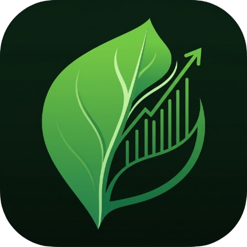
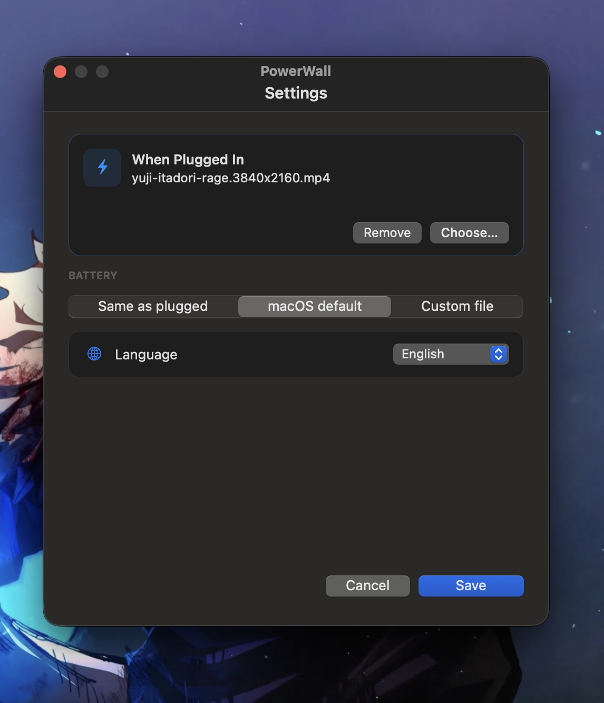
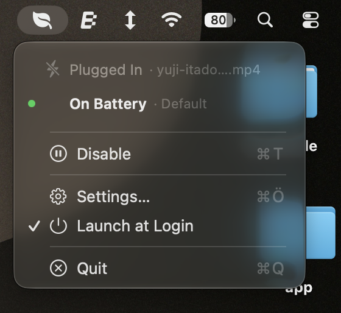

    

  <h1>PowerWall</h1>

  
<strong>Your wallpaper knows when you're plugged in.</strong> 
  A lightweight macOS menu bar app that automatically switches your wallpaper 
  the instant your power state changes — with a cinematic fade transition.

  
  
  
  
  
  
  

    

  > **macOS menu bar app** · **automatic wallpaper switching** · **power state detection** · **fade transition** · **Swift** · **open source**

> 🗺️ **2.0 is coming:** CPU-aware pausing and a built-in wallpaper library. See the [Roadmap](ROADMAP.md).

---

## Demo

---

## Screenshots

  
  &nbsp;
  
  &nbsp;
  
   
  Settings window · Menu when plugged in · Menu on battery

---

## What it does

Set a wallpaper for **plugged in** and a separate one for **on battery**. The moment macOS sees a power state change, PowerWall fires in under 100 ms — no manual action needed. Plug in your charger and your desk wallpaper appears. Unplug and it switches back. Transitions use a smooth fade to black so the swap never feels abrupt.

Supports video loops (MP4/MOV), animated GIFs, and static images (PNG/JPG/HEIC/WEBP).

---

## Performance

| Metric | Value | Notes |
|---|---|---|
| ⚡ Detection latency | **< 100 ms** | IOKit callback fires instantly on hardware event |
| 🧠 Memory footprint | **~12 MB** | Idle, no video playing |
| ⚙️ CPU usage | **~0%** idle · **< 1%** on event | Measured on M-series chip |
| 🚀 Startup time | **< 0.3 s** | From launch to menu bar ready |
| 📦 App bundle size | **< 1 MB** | Compiled binary only |
| 🎬 Supported formats | **7** | MP4 · MOV · GIF · PNG · JPG · HEIC · WEBP |
| 📝 Swift source | **~800 lines** | 9 files, zero dependencies |
| 🖥️ macOS requirement | **14 Sonoma+** | arm64 + x86_64 |

---

## How detection works
