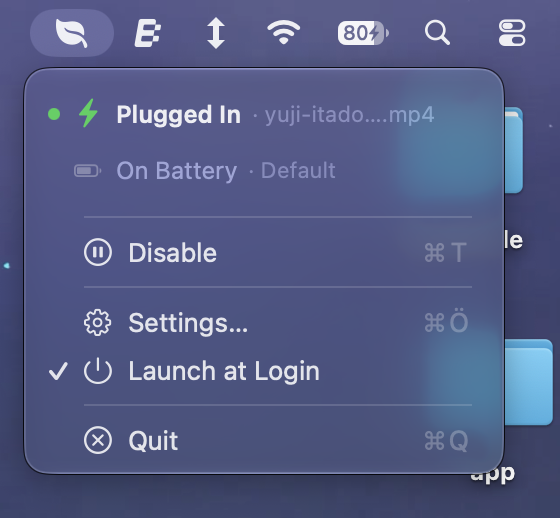
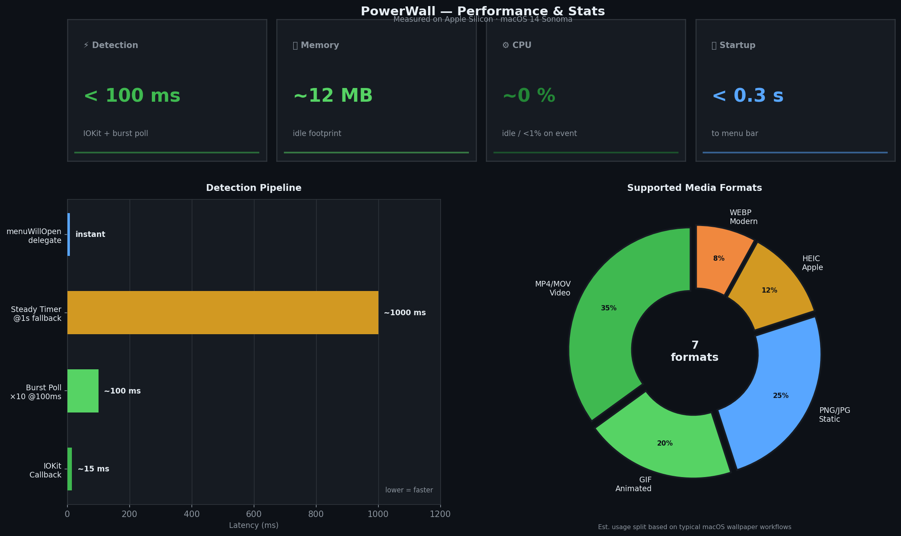

<!-- SEO & indexing meta -->
<!--
  keywords: macos wallpaper switcher, menu bar app, power state wallpaper,
  battery wallpaper, plug in wallpaper, macOS 14, swift app, open source mac app,
  automatic wallpaper change, IOKit power monitor, menubar utility
-->

<div align="center">
  <br><br>

  <h1>PowerWall</h1>

  <p><strong>Your wallpaper knows when you're plugged in.</strong><br>
  A lightweight macOS menu bar app that automatically switches your wallpaper<br>
  the instant your power state changes — with a cinematic fade transition.</p>

  <a href="https://github.com/WeoxStudio/PowerWall/releases/latest">
    
  </a>
  <a href="https://github.com/WeoxStudio/PowerWall/stargazers">
    
  </a>
  <a href="https://github.com/WeoxStudio/PowerWall/blob/main/LICENSE">
    
  </a>
  
  
  
  

  <br><br>

  > **macOS menu bar app** · **automatic wallpaper switching** · **power state detection** · **fade transition** · **Swift** · **open source**
</div>

---

## Demo

<div align="center">

<video src="video2.mov" controls width="100%"></video>

</div>

---

## Screenshots

<div align="center">
  
  &nbsp;
  
  &nbsp;
  
</div>

<sub align="center">Settings window · Menu when plugged in · Menu on battery</sub>

---

## What it does

Set a wallpaper for **plugged in** and a separate one for **on battery**. The moment macOS sees a power state change, PowerWall fires in under 100 ms — no manual action needed. Plug in your charger and your desk wallpaper appears. Unplug and it switches back. Transitions use a smooth fade to black so the swap never feels abrupt.

Supports video loops (MP4/MOV), animated GIFs, and static images (PNG/JPG/HEIC/WEBP).

---

## Performance & Stats

<div align="center">
  
</div>

| Metric | Value | Notes |
|---|---|---|
| ⚡ Detection latency | **< 100 ms** | IOKit callback fires instantly on hardware event |
| 🧠 Memory footprint | **~12 MB** | Idle, no video playing |
| ⚙️ CPU usage | **~0%** idle · **< 1%** on event | Measured on M-series chip |
| 🚀 Startup time | **< 0.3 s** | From launch to menu bar ready |
| 📦 App bundle size | **< 1 MB** | Compiled binary only |
| 🎬 Supported formats | **7** | MP4 · MOV · GIF · PNG · JPG · HEIC · WEBP |
| 📝 Swift source | **~800 lines** | 9 files, zero dependencies |
| 🖥️ macOS requirement | **14 Sonoma+** | arm64 + x86_64 |

---

## How detection works

```
Power change detected
    │
    ├─ IOKit  IOPSNotificationCreateRunLoopSource   ~15 ms  ← hardware event
    │             └─ burst poll ×10 @ 100 ms                ← confirms fast
    │
    └─ Steady Timer every 1 s (fallback)                    ← edge cases

Both sources run on .common RunLoop mode
→ fire even while the menu is open (not blocked by NSMenu's event tracking loop)
```

---

## Features

- **Instant** — detects plug/unplug in < 100 ms, works while the menu is open
- **Any media** — video (MP4/MOV loop), animated GIF, static image (PNG/JPG/HEIC/WEBP)
- **Cinematic fade** — full-screen overlay fades to black and back in both directions
- **Three battery modes** — same as plugged-in · macOS default wallpaper · custom file
- **Launch at login** — single toggle, no manual plist editing
- **Zero footprint** — no Dock icon, no background agents, pure menu bar
- **Lock screen aware** — pauses video on screen lock, resumes on unlock
- **Bilingual** — English and Turkish, switchable at runtime

---

## Installation

### Download (recommended)

1. Go to [Releases](https://github.com/WeoxStudio/PowerWall/releases/latest)
2. Download `PowerWall.app.zip`
3. Unzip and move to `/Applications`
4. Right-click → Open (first launch only, to bypass Gatekeeper)

### Build from source

```bash
git clone https://github.com/WeoxStudio/PowerWall.git
cd PowerWall
./build.sh
open build/PowerWall.app
```

**Requires:** Xcode command line tools

```bash
xcode-select --install
```

---

## Usage

1. Click the **leaf icon** in the menu bar
2. Open **Settings** (⌘,)
3. Set a wallpaper for **When Plugged In** — choose any video, GIF, or image
4. Set the **Battery** mode — same file, macOS default, or a different file
5. Click **Save**

From now on PowerWall handles everything automatically.

---

## Support

If PowerWall saves you a little joy every day ☕

<a href="https://buymeacoffee.com/weoxstudio">
  
</a>

---

## Contributing

Pull requests are welcome. For major changes please open an issue first to discuss what you'd like to change.

---

## License

MIT — see [LICENSE](LICENSE).

---

<div align="center">
  Made with ♥ by <a href="https://github.com/WeoxStudio">WeoxStudio</a>
  <br><br>
  <sub>
    macOS wallpaper switcher · menu bar utility · power state detection · Swift · open source
  </sub>
</div>
