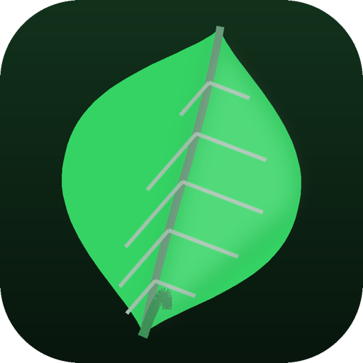
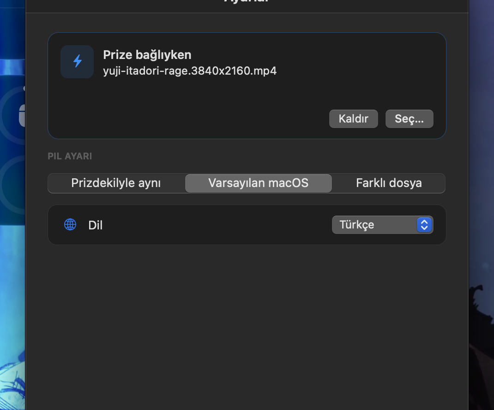
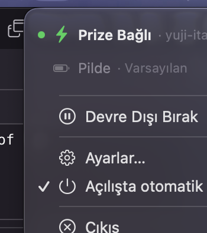

<div align="center">
  
  <h1>PowerWall</h1>
  <p>macOS menu bar app that automatically switches your wallpaper when you plug in or unplug your charger.</p>

  <a href="https://github.com/WeoxStudio/PowerWall/releases"></a>
  <a href="https://github.com/WeoxStudio/PowerWall/stargazers"></a>
  <a href="https://github.com/WeoxStudio/PowerWall/blob/main/LICENSE"></a>
  
  
  <br><br>

  
</div>

---

## What it does

PowerWall lives in your menu bar and watches your power source. The moment you plug in or unplug your charger, it switches your wallpaper — with a smooth fade transition. Set a video, GIF, or image for each state and forget about it.

<div align="center">
  
</div>

## Features

- **Instant switching** — detects power changes in real time, even while the menu is open
- **Any media** — supports MP4, MOV, GIF, PNG, JPG, HEIC
- **Fade transition** — smooth black fade between wallpapers in both directions
- **Battery mode options** — same as plugged-in, default macOS wallpaper, or a different file
- **Launch at login** — single toggle, no manual setup
- **Multilingual** — English and Turkish built in
- **Zero background activity** — no dock icon, no app window, pure menu bar

## Screenshots

| Settings | Menu |
|----------|------|
|  |  |

## Requirements

- macOS 14 Sonoma or later
- Apple Silicon or Intel Mac

## Build from source

```bash
git clone https://github.com/WeoxStudio/PowerWall.git
cd PowerWall
./build.sh
open build/PowerWall.app
```

Requires Xcode command line tools (`xcode-select --install`).

## How it works

PowerWall uses `IOPSNotificationCreateRunLoopSource` for instant power state detection and falls back to a 1-second polling timer — both running on `.common` RunLoop modes so they fire even when the menu is open. Wallpaper transitions use a full-screen overlay window that fades to black and back.

## License

MIT — see [LICENSE](LICENSE).

---

<div align="center">
  Made with ♥ by <a href="https://github.com/WeoxStudio">WeoxStudio</a>
</div>
