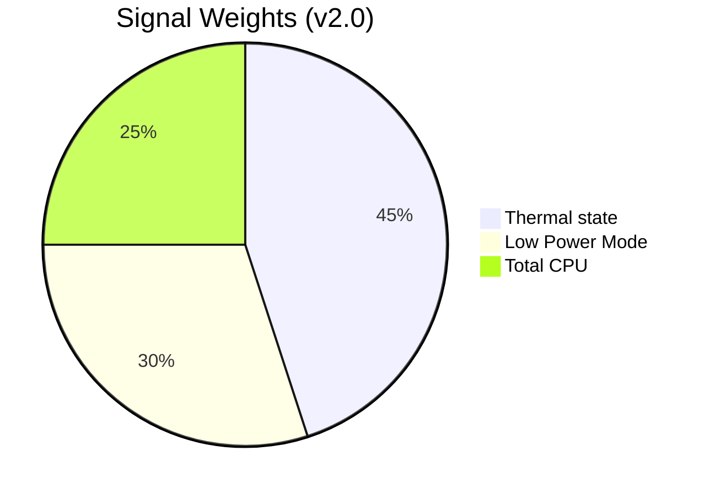

# 🗺️ PowerWall 2.0 Roadmap

> 🚀 Goal: A smarter, lighter, more user-friendly live wallpaper experience.

**Target release window:** within the first 3 months (Q1 2026).

## 📊 Metrics (aligned with README)

| Metric | v1.0 | v2.0 Target | Notes |
|---|---|---|---|
| ⚡ Detection latency | < 100 ms | < 100 ms | IOKit hardware event |
| 🧠 Memory footprint | ~12 MB | ~12 MB | Idle, no video playing |
| ⚙️ CPU usage | ~0% idle / <1% event | lower under load | M-series chip |
| 🚀 Startup time | < 0.3 s | < 0.3 s | Launch to menu bar ready |
| 📦 App bundle size | < 1 MB | < 1 MB | Compiled binary only |
| 🎬 Supported formats | 7 | 7 | MP4 · MOV · GIF · PNG · JPG · HEIC · WEBP |
| 📝 Swift source | ~800 lines | ~1200 lines | 9 → 12 files, zero deps |

## 🧠 Part 1: CPU-load-aware protection ⚡

- 🔋 Thermal state + Low Power Mode as primary signals
- 📈 Total CPU as a secondary signal
- 🔁 Stable transitions (hysteresis + short rolling averages)
- 🔔 One notification per load spike, muteable
- 🎛️ Toggle + sensitivity + pause reason shown in menu
- 🎬 Reuse existing fade transition
- 📉 Proof: README CPU/energy measurements with feature on/off

## 📚 Part 2: Built-in Library 🎨

A curated, on-demand downloadable collection of live wallpapers. Users browse categories, preview, and install with one click; content is stored in a known folder and can be removed at any time.

- 🪶 Keep app < 1 MB (content downloaded on demand)
- 🗂️ Separate content manifest (name, category, preview, size, license, author)
- ⚖️ Only redistributable content, author + license shown
- 🎞️ Short, seamless, low-bitrate loops
- 🔒 Network only when library is used, no data collection
- ✅ Download verification, error handling, cancel
- 📁 Known folder + user can delete
- 🖥️ "Library" tab, categories, previews, progress
- 🔌 Assign to plugged/battery; moving content on battery triggers "notify only" rule

## ☕ Support & Contact

- ▶️ [YouTube Channel](https://www.youtube.com/@Tuna-zpxv)
- 💛 [Buy Me a Coffee](https://buymeacoffee.com/tunazpxv)
- 📧 Contact: tunazpxv@gmail.com

---

Made with ♥ by [TunaZpxv](https://github.com/TunaZpxv)
